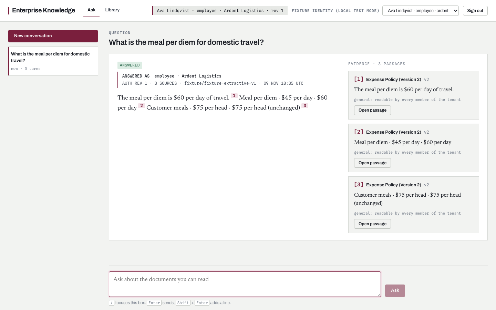

# Enterprise Knowledge

**The right answer. For the right person.**

Retrieval permissions must still hold after an answer has been cached or a link has been saved. Enterprise Knowledge applies authorization across retrieval, history, citations and exports.

Built by **Mohammed Abumtary** · TypeScript · React · Hono · PostgreSQL RLS · revision-aware retrieval

[Demo guide](docs/DEMO.md) · [Engineering notes](docs/ENGINEERING.md) · [Verification & boundaries](docs/VERIFICATION.md) · [Recorded walkthrough](media/walkthrough.mp4)

## The experience

Choose an identity → ask → open a passage → switch permissions and compare.

Two fictional organizations and 40 synthetic documents. The demo identity selector is restricted to local use.

## Where the engineering matters

### Enforce tenant scope inside the database

A non-owner application role, forced row-level security and transaction-local identity keep pooled requests from inheriting another tenant's context.

### Recheck after the slow model step

Generation happens outside the database transaction. Authorization revision and readable sources are checked again before the answer is committed.

### Revoke every route to the content

The same permission change affects cached answers, direct citations, conversation history and exports—not only the initial search.

## Verified in the demonstration

- 11 database regressions and six browser checks passed in the current verification pass.
- Recorded identity switching and source-backed answer inspection.
- Documented denial behavior uses neutral not-found responses for inaccessible objects.

## Explore the work

This private repository is a presentation package: screenshots, walkthrough media and engineering notes. Application source, credentials and customer records are not included. The interactive demonstration runs in a separate local review environment; access can be arranged for a walkthrough.

[Read the guided demo](docs/DEMO.md) · [View my portfolio](https://mohammed-ab.github.io/)

## Scope

Revocation prevents later protected access; it cannot erase information someone already saw. Synthetic tests are not an external security audit.

Reviewed 10 November 2026. Results describe the recorded build and stated test scope.
